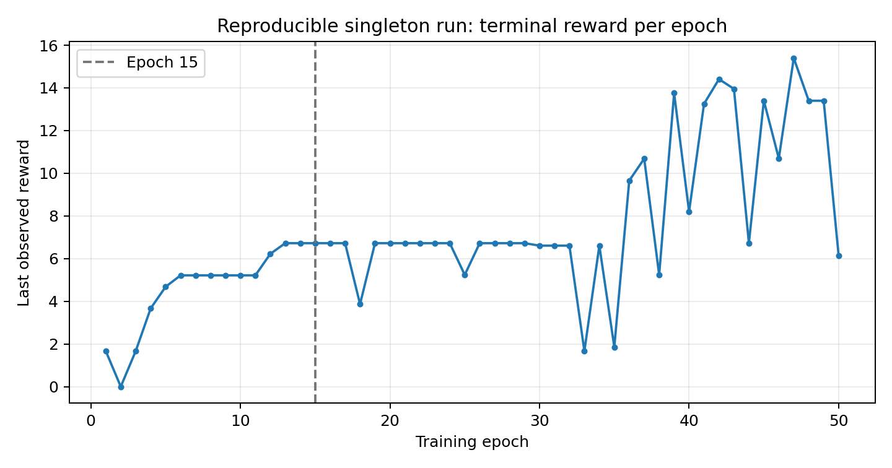
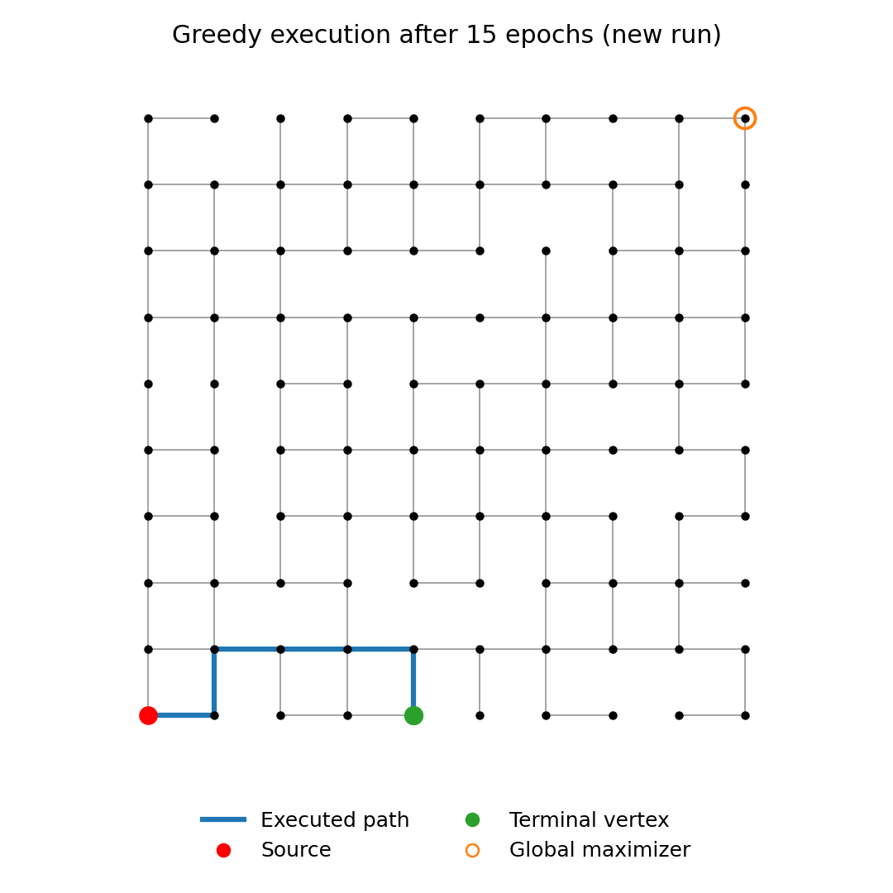
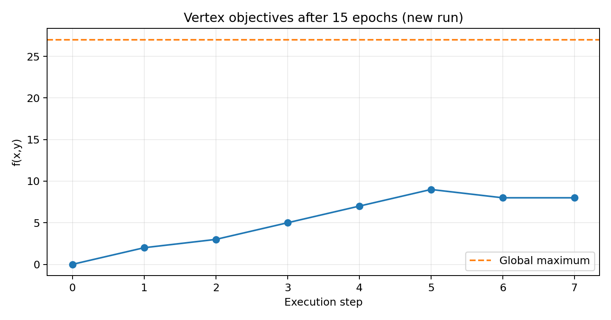

# Graph_RL — graph metrics and Lipschitz reward learning

Reproducible examples for the revised manuscript *Extending graph metrics
to hyperspaces of vertex sets: optimization and reinforcement learning
applications*, submitted to the *Journal of Combinatorial Optimization*
(JCO). The article-specific implementation,
version 1.0.0, is independent of the earlier exploratory scripts.

## Installation and execution

Use CPython 3.12 (tested with 3.12.14). NetworkX 3.4.2, Matplotlib 3.10.8,
NumPy 2.3.5 and the plotting dependencies are pinned in
[`requirements.txt`](requirements.txt).

```bash
git clone https://github.com/serjj99/Graph_RL.git
cd Graph_RL
python -m venv .venv
source .venv/bin/activate       # Windows PowerShell: .venv\Scripts\Activate.ps1
python -m pip install -r requirements.txt
python -m unittest discover -s tests -v
python run_article_examples.py
```

The last command runs both examples and exports their data and plots
to [`results/article_run/`](results/article_run/). It does not require a
display or a pre-existing model. To preserve the checked-in run while
executing another instance, use `--output results/local/reproduction`.

```bash
python run_article_examples.py --output results/local/reproduction \
  --graph-seed 0 --train-seed 0 --execution-seed 0 \
  --epochs 50 --checkpoint 15 --max-steps 100 --epsilon 0.05
```

All three seeds are independent. The output manifest records the Python
and library versions, configuration, source hashes and comparison with
the historical graph and path. Rewards, distances and maximizer ties
are computed using exact rational arithmetic. Plotting converts the
values to floating point only for display.

## 1. Singleton trajectories on a grid

The graph is the 10-by-10 unweighted square grid. Vertex IDs are
`10*x+y`, with coordinates 0 to 9. Starting with 180 edges, the generator
uses seed 0 and accepts random edge removals only if connectivity is
preserved. The resulting 100 vertices and 144 edges match Figure 2 of
the manuscript exactly.

The objective is `f(x,y) = 2*x+y`. Its unique global maximizer is (9,9),
with value 27. The trajectory is a sequence of singleton vertex sets.
The trajectory distance uses terminal padding and uniform weights
`w_i = 1/100` for i=1,...,100, and zero thereafter. The action component
of the product metric is the graph path distance. For a trajectory of
length n, the reward associated with action a is

$$
R(\phi,a)=\sum_{i=1}^n\frac{2i}{(n+1)(n+2)}f(\phi_i)
            +\frac{2}{n+2}f(a).
$$

The replay buffer stores distinct trajectory-action-reward records. The
first observation is exploratory; subsequently an action is chosen
uniformly at random with probability 0.05, or by maximizing the mean
of the McShane and Whitney extensions otherwise. Tied maximizers are
chosen uniformly at random. Candidate order is ascending unvisited
neighbor ID, followed by the current vertex. A terminal self-action
is recorded once and ends the episode; otherwise the episode stops at
the step limit. The empirical Lipschitz seminorm is updated
incrementally before greedy decisions and synchronized with all stored
records before evaluation. Each pair is processed once in these
updates. Zero-distance observations are checked for reward consistency.

Each epoch restarts at (0,0). For the new reference run, the training
seed is 0, the horizon is 100, and the total number of epochs is 50.
The greedy execution at epoch 15 uses a separate execution RNG with
seed 0 and does not modify the training buffer. A second greedy
execution uses the complete 50-epoch buffer. The plotted statistic is
the **observed reward of the last executed transition of each training
epoch** (not a cumulative or mean reward). This definition applies to
the newly generated plot, not to the historical reward graph.

### Historical versus newly verified results

The original [`reference/`](reference/) files encode the graph and
trajectory transcribed from Figures 2 and 3. The exact historical
training code, RNG configuration and Figure 1 reward statistic are not
recoverable from the previous public commit `93bf33a`.

| Run | Epochs before greedy execution | Terminal vertex | Objective |
| --- | ---: | --- | ---: |
| Historical manuscript trajectory | 15 | (9,9) | 27 |
| New verified reference run, seed 0 | 15 | (4,0) | 8 |
| New verified reference run, seed 0 | 50 | (9,1) | 19 |

The new run reproduces the **graph**, but not the historically observed
trajectory or reward curve. Its figures are new and must not be
described as reproductions of the manuscript's original numerical
results. Global optimality is not guaranteed by this heuristic.







An optional check with the fixed training seeds 0, 1, 2, 3 and 4 is
included in [`results/seed_check.csv`](results/seed_check.csv). It
reports all five runs, without selecting a successful seed.

| Training seed | Objective after 15 epochs | Objective after 50 epochs |
| ---: | ---: | ---: |
| 0 | 8 | 19 |
| 1 | 21 | 20 |
| 2 | 10 | 10 |
| 3 | 13 | 19 |
| 4 | 10 | 23 |

```bash
python run_seed_check.py --output results/local/seed_check.csv
```

## 2. Worked example with non-singleton states (Remark 3)

Let o=(0,0), b=(1,0), c=(0,1), z=(1,1). These four vertices
form a square in the manuscript graph. Consider the cumulative trajectories

- phi = ({o}, {o,b}, D), where D={o,b,z};
- psi = ({o}, {o,c}, D'), where D'={o,c,z}.

The coordinatewise Hausdorff distances are 0, 1 and 1. Repeating the
last sets and using the positive summable weights
`w_i = 2^(-i)` gives eta_H(phi,psi)=1/2, calculated using the exact
infinite tail.

For target set D let u(A)=-d_H(A,D); this is 1-Lipschitz. With
the common next cumulative state a={o,b,c,z}, consider

$$
R_D(\chi,a)=\sum_{i=1}^{\infty}w_i u(\widetilde{\chi}_i)+u(a).
$$

The script verifies the following quantities exactly:

| Quantity | Value |
| --- | ---: |
| eta_H(phi,psi) | 1/2 |
| nu((phi,a),(psi,a)) | 1/2 |
| R_D(phi,a) | -9/4 |
| R_D(psi,a) | -5/2 |
| Absolute reward difference | 1/4 |
| Empirical seminorm of the two records | 1/2 |

The reward satisfies the Lipschitz inequality with constant 1; the
observed two-record seminorm is 1/2. Both McShane--Whitney extensions
interpolate the observed rewards. This example is an analytical
calculation, not a second stochastic training experiment. It keeps the
same seed-0 manuscript graph even if the numerical grid seed is changed.
See [`set_valued_example.json`](results/article_run/set_valued_example.json).

## Output files

| File | Contents |
| --- | --- |
| `manifest.json` | Configuration, versions and source hashes |
| `graph_edges.csv` | Exact graph edge list |
| `reward_progression.csv` | Terminal reward by epoch, exact and decimal |
| `episodes.json` | Complete training trajectories, rewards and stop reasons |
| `checkpoint_trajectory.csv` | Greedy path after 15 epochs and f values |
| `checkpoint_execution.json`, `final_execution.json` | Greedy paths, seminorms and buffer sizes |
| `replay_buffers.json` | Exact distinct records at epochs 15 and 50 |
| `set_valued_example.json` | Analytic worked-example calculations |
| `reference_comparison.json` | Historical graph/path comparisons |
| Three PNG files | Reward, path and objective plots of the new run |

## Implementation and tests

- `article_core.py`: graph path distance (cached on demand), general
  finite-subset Hausdorff distance, terminal-padded trajectory distance
  with exact weight tails, and the incremental replay predictor.
- `run_article_examples.py`: graph generation, training, frozen greedy
  evaluation, set-valued worked example, export and plotting.
- `tests/`: verifies the historical edge set, objective values,
  Hausdorff computations, tail handling, zero-distance reward
  consistency, interpolation, pair counts, stopping and reproducibility.
- The previous `config.py`, `RL_graphs_functions.py`, `train_RL.py`
  and `load_model.py` are retained as legacy exploratory scripts.
  They concern different configurations and should **not** be used to
  reproduce the article examples. For their dependencies, see
  `requirements-legacy.txt`.
